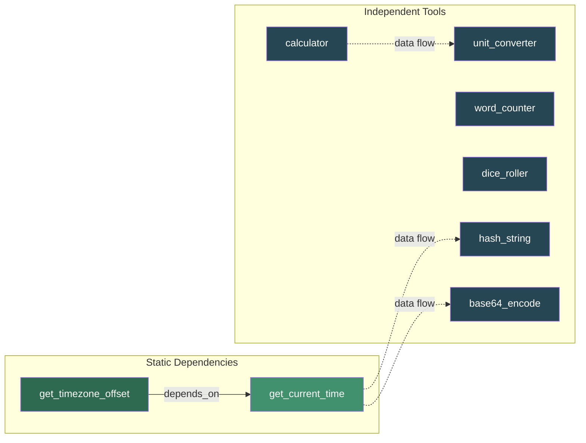
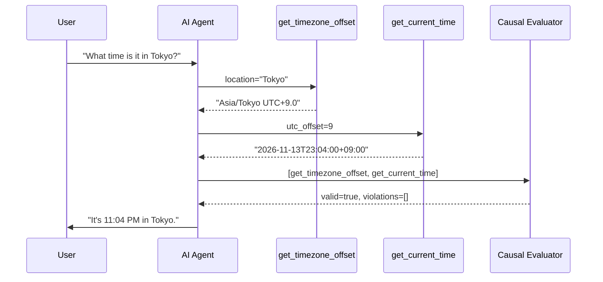
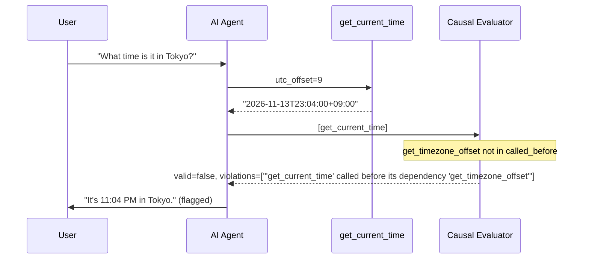
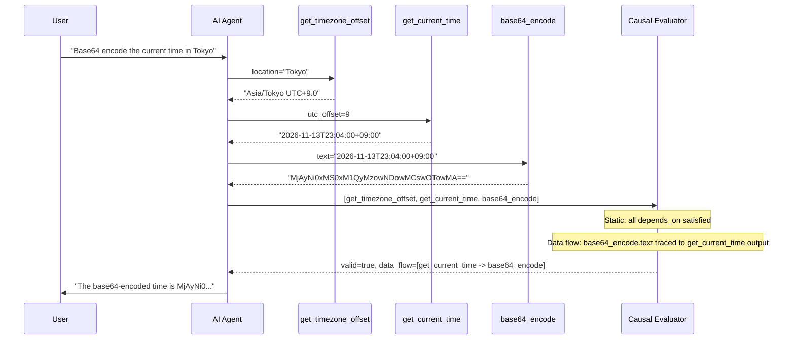
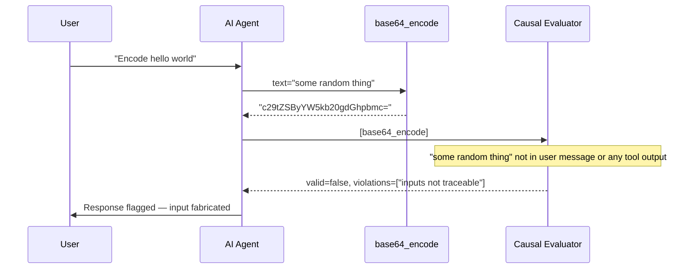

# Causal DAG

Tool dependency validation enforced by the causal evaluator (`AI/causality.py`). Two layers work together:

1. **Static DAG** — hard constraints declared in `TOOL_SCHEMAS` via `depends_on`. These are mandatory prerequisites that always apply (e.g. `get_current_time` always requires `get_timezone_offset`).

2. **Data-flow tracing** — runtime analysis of ad-hoc chains. For each tool call, the evaluator traces whether its input values came from a preceding tool's output or from the user's message. Tools whose inputs can't be traced to any source are flagged as ungrounded.

## Current DAG



Solid arrows are static `depends_on` constraints (always enforced). Dashed arrows are example data-flow edges (discovered at runtime — any tool can feed into any other).

`get_current_time` is the only tool with a static dependency — it always requires `get_timezone_offset` first. All other tools are independent roots that can chain dynamically via data flow.

### Static DAG evaluation



### Static DAG violation



### Ad-hoc data-flow chain

No static dependency between `get_current_time` and `base64_encode`, but the data-flow layer traces the value through:



### Ungrounded data-flow violation



## Dependency table

| Tool | `depends_on` | Reason |
|------|-------------|--------|
| `get_timezone_offset` | — | Standalone lookup; no prerequisite |
| `get_current_time` | `get_timezone_offset` | Needs the UTC offset — model must not guess it |
| `calculator` | — | Self-contained arithmetic |
| `unit_converter` | — | Self-contained conversion |
| `word_counter` | — | Self-contained text analysis |
| `dice_roller` | — | Self-contained RNG |
| `hash_string` | — | Self-contained hash computation |
| `base64_encode` | — | Self-contained encoding |

## How the evaluator works

`check_causality(records, user_message)` in `AI/causality.py` runs two passes over the execution records:

### Layer 1: static DAG

1. Iterate through records in execution order
2. For each tool, look up its `depends_on` list from `TOOL_SCHEMAS`
3. Check that every dependency appears in the `called_before` set
4. If a dependency is missing, record a violation

### Layer 2: data-flow tracing

1. For each tool call, extract all input values (strings, numbers — recursively from nested dicts/lists)
2. For each value, search (in order): the user's original message, then each preceding tool's output
3. If a value is found, record a `DataFlowEdge` from the source tool to the current tool
4. If ALL of a tool's input values are untraceable (not in the user message, not in any tool output), record an ungrounded violation

### CausalResult schema

```json
{
  "valid": true,
  "tool_sequence": ["get_timezone_offset", "get_current_time", "base64_encode"],
  "violations": [],
  "data_flow": [
    {
      "from_tool": "get_current_time",
      "to_tool": "base64_encode",
      "values": ["2026-11-13T23:04:00+09:00"]
    }
  ]
}
```

The `data_flow` field is the runtime-discovered dependency graph — it shows which tools actually fed data into which other tools, regardless of static declarations.

## Step faithfulness

The causal evaluator checks ordering. A separate evaluator (`AI/step_faithfulness.py`) checks that values flow correctly between consecutive tool calls:

- **Value carryforward**: did a numeric or string value from the previous tool's output appear in the next tool's input?
- **Semantic similarity**: BERT cosine similarity between the previous output and the next tool's arguments (threshold: 0.25)

A step is faithful if either check passes. This catches the model misinterpreting intermediate results — e.g. getting `UTC+9.0` from the timezone tool but passing `utc_offset=8` to the time tool.

## Adding a dependency

To add a dependency between tools, update the `depends_on` list in `TOOL_SCHEMAS`:

```python
TOOL_SCHEMAS["your_tool"] = {
    "input": YourToolInput,
    "output": YourToolOutput,
    "extractor": your_extractor,
    "depends_on": ["prerequisite_tool"],
}
```

The evaluator handles transitive chains automatically — if A depends on B and B depends on C, then calling A before C is a violation because B must come first, and B requires C before it.

## Enforcement

The causal result is attached to the final AI message in `additional_kwargs["causality"]` and persisted to Redis as part of the session. It is currently annotation-only — violations are recorded but do not block the response. To enforce strict ordering, the agent loop in `AI/agent.py` could reject the response and re-prompt when `valid` is false.
